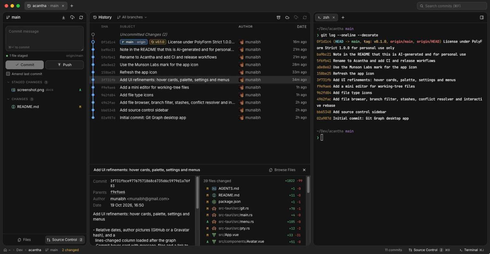

<div align="center">


# Acantha

A Git client for macOS: a commit graph, terminals, a Git panel and an editor, side by side.

**AI-generated and sense-checked · inspired by [Terax](https://github.com/crynta/terax-ai) · for personal use only**

[**Download**](https://github.com/munsonlabs/acantha/releases/latest) ·
[](https://github.com/munsonlabs/acantha/actions/workflows/ci.yml)
[](https://github.com/munsonlabs/acantha/actions/workflows/release.yml)
[](LICENSE)

</div>

> [!IMPORTANT]
> **This project is entirely AI-generated**, written with Claude and sense-checked by a person rather than written by hand. It's **inspired by [Terax](https://github.com/crynta/terax-ai)**, whose look and layout it follows, and by the VS Code Git Graph extension. It was built **for personal use only**: it is not a supported product, and comes with no guarantees. The licence, [PolyForm Strict 1.0.0](LICENSE), allows personal and other non-commercial use only, and no redistribution or modified versions.



## Features

Built with Tauri 2, Rust and Vue 3.

- Tabs in the titlebar, one per repository, restored on the next launch
- A Git panel: write a commit message, stage, unstage and discard files, view staged or unstaged diffs, amend, push and pull
- A terminal pane next to each graph, with its own tabs, starting in the repository (`portable-pty` + xterm.js)
- A file browser for the working tree or any commit, with highlighted code, rendered Markdown, images, blame and file history
- A small editor (CodeMirror, optional Vim keys) for working-tree files: ⌘S to save, Save & Stage, a warning before losing unsaved changes or overwriting edits made elsewhere, and Open in VS Code, Cursor, Zed or another app
- Branch filter: show any set of branches, or all of them; stashes in the graph, which can be hidden
- A merge conflict resolver (accept current, incoming or both per conflict, or edit it by hand) with Continue/Abort for merges, rebases and cherry-picks
- Interactive rebase: reorder by dragging, then pick, reword, edit, squash, fixup or drop
- Commit graph across all branches, remotes and tags, with the working tree shown as an "Uncommitted Changes" row
- Commit details with changed files and a line-numbered diff view
- Cmd/Ctrl-click a second commit to compare the two
- Right-click commits, branches, remote branches and tags for checkout, branch, tag, merge, rebase, cherry-pick, revert, reset, push, stash and delete
- Branch filter, remote-branch toggle, find (⌘F) and fetch
- Watches the working tree while the window is focused, so changes made in the terminal or an editor show up
- Open a repo from the toolbar, by dropping its folder onto the window, or from the command line

## Interface

- Relative dates ("3h ago"), author pictures from GitHub or Gravatar, and a lines-changed column
- Hover a commit for a card with its message, files and a link to the commit online; hovering also highlights its branch line
- A command palette (⌘P) for commands, branches, files, commits and recent repositories
- Settings (⌘,), a native menu bar, and a shortcuts sheet (⌘/)
- Tabs with a sliding highlight, reordered by dragging

## Shortcuts

| Keys          | Action                                              |
| ------------- | --------------------------------------------------- |
| ⌘T / ⌘W       | New tab / close tab (or the terminal, when focused) |
| ⌘1–9, ⌘⇧[ ⌘⇧] | Switch tabs                                         |
| ⌘P            | Command palette                                     |
| ⌘,            | Settings                                            |
| ⌘/            | Keyboard shortcuts                                  |
| ⌘B            | Show or hide the sidebar (Files and Git)            |
| ⌘+ / ⌘− / ⌘0  | Interface size: bigger, smaller, actual size        |
| ⌘↵            | Commit (in the message box)                         |
| ⌘J            | Show or hide the terminal                           |
| ⌃⇧`           | New terminal tab                                    |
| ⌘K            | Clear the terminal                                  |
| ⌘F / ⌘R / ⌘O  | Search commits / refresh / open a repository        |

## Install

Download the `.dmg` for your Mac from [Releases](https://github.com/munsonlabs/acantha/releases): **aarch64** for Apple Silicon, **x64** for Intel. The app isn't notarised yet, so the first time, right-click Acantha in Applications and choose **Open**.

## Develop

Requires Node (see `.node-version`), Rust (`rustup`) and git.

```bash
vp i
vp config     # installs the pre-commit hook; .npmrc sets ignore-scripts, so it isn't automatic
npm run dev   # tauri dev, which starts `vp dev` on port 1420
npm run check # vp check (fmt, lint, types) + vue-tsc for templates
npm run build # release .app / .dmg under src-tauri/target/release/bundle
```

Backend tests run against a throwaway repo: `cd src-tauri && cargo test`.

Open a specific repo on launch by passing its path to the binary:

```bash
"src-tauri/target/release/bundle/macos/Acantha.app/Contents/MacOS/acantha" ~/code/my-repo
```

## Releasing

Bump `version` in `src-tauri/tauri.conf.json` and `package.json`, commit, then tag and push:

```bash
git tag v0.2.0 && git push origin v0.2.0
```

The Release workflow builds the app for Apple Silicon and Intel on GitHub's macOS runners and publishes both `.dmg` files to the Releases page. CI runs the checks and tests on every push.

## Licence

[PolyForm Strict 1.0.0](LICENSE): free for personal and other non-commercial use. It doesn't allow commercial use, redistributing the app, or publishing modified versions.
